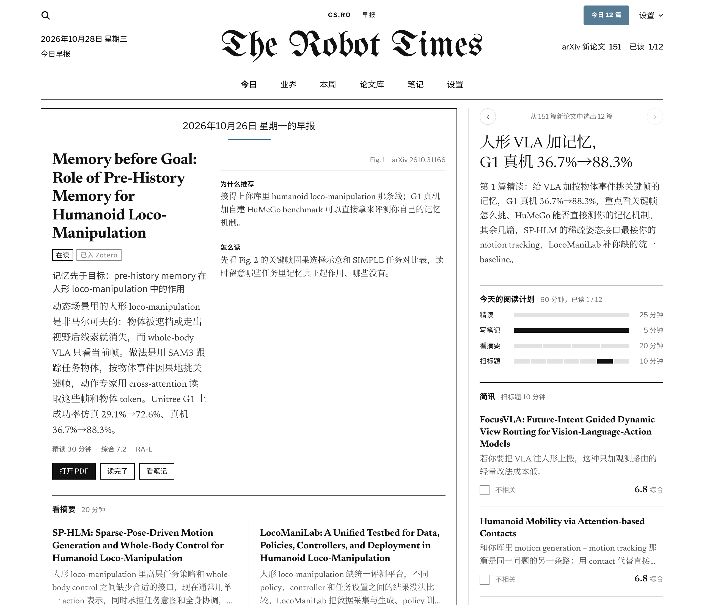
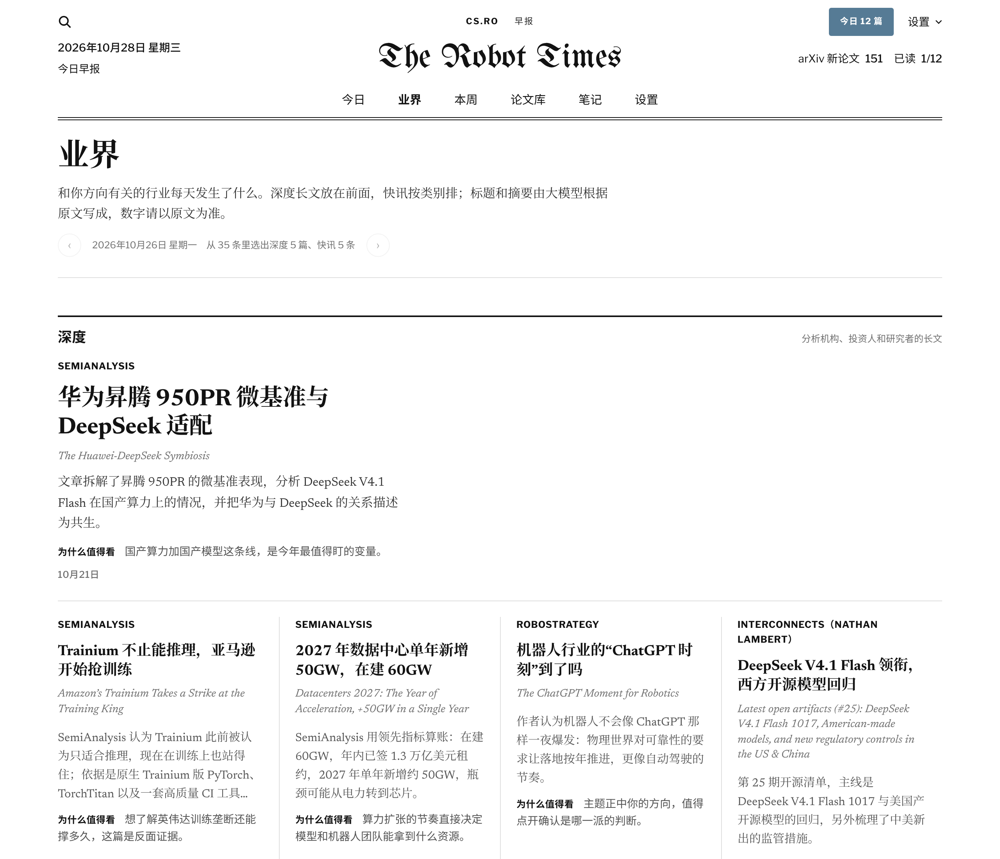

<div align="center">

# The Robot Times

**每天早上一份属于你的论文早报**

从 arXiv 新论文里挑出你该读的几篇，写好中文解读，排进阅读计划，一键放进 Zotero。

[](https://github.com/huxiaoyi-ovo/robot-times/actions/workflows/ci.yml)
[](LICENSE)

[快速开始](#快速开始) · [怎么用](#每天怎么用) · [常见问题](#常见问题) · [English](README.en.md)



</div>

## 它能帮你做什么

- **挑论文**：根据你的 Zotero 文献库和研究兴趣，每天从一两百篇新论文里挑出十几篇。
- **写解读**：每篇都有中文标题和摘要；重点论文读完全文，写一段有判断的评论，配上关键图表。
- **排计划**：分成精读、看摘要、扫读三档，按你每天能花的时间排好。
- **进 Zotero**：点一下就加进你指定的文件夹，PDF 和摘要笔记一起带上。
- **越用越准**：点“多推这类”“少推这类”、加入 Zotero、标记读完，都会影响之后的推荐。
- **还有**：每天一份业界简报（行业新闻和深度长文），每周一份回顾和下周计划，可以对着论文“问 AI”。

默认是机器人方向，其他方向在设置里换一下就行。

| 论文详情 | 业界简报 | 手机上看 |
| :---: | :---: | :---: |
|  |  |  |

## 快速开始

装在你自己的电脑上，数据都留在本机，不需要注册任何服务，也不用开终端。大约 5 分钟。

**第 1 步：装好 Zotero**

装好 [Zotero](https://www.zotero.org/download/) 10 或更新版本，打开一次就行。

**第 2 步：下载安装包，双击安装**

| 系统 | 下载 |
| --- | --- |
| Windows 10 / 11 | [RobotTimes-Windows-Setup.exe](https://github.com/huxiaoyi-ovo/robot-times/releases/latest/download/RobotTimes-Windows-Setup.exe) |
| macOS 11 及以上（Intel 和 M 系列都行） | [RobotTimes-macOS.pkg](https://github.com/huxiaoyi-ovo/robot-times/releases/latest/download/RobotTimes-macOS.pkg) |
| Ubuntu / Debian 等（大多数电脑） | [robot-times_amd64.deb](https://github.com/huxiaoyi-ovo/robot-times/releases/latest/download/robot-times_amd64.deb) |
| Ubuntu / Debian 等（ARM，比如树莓派） | [robot-times_arm64.deb](https://github.com/huxiaoyi-ovo/robot-times/releases/latest/download/robot-times_arm64.deb) |

安装包没有花钱买开发者签名，系统第一次会拦一下：

- **Windows**：出现“Windows 已保护你的电脑”时，点 **更多信息 → 仍要运行**。
- **macOS**：提示“无法验证开发者”时，打开 **系统设置 → 隐私与安全性**，在下面点 **仍要打开**，再双击一次安装包。
- **Linux**：双击 .deb 用“软件”安装；或者在下载文件夹里运行 `sudo apt install ./robot-times_amd64.deb`。

**第 3 步：按网页上的引导设置**

装好后浏览器会自动打开 <http://localhost:8765>（第一次要下载约一分钟的依赖）。网页上一步步带你：

1. 连上 Zotero（页面上有按钮帮你打开 Zotero 的本地接口，Zotero 弹窗时点 **Always Allow**）
2. 写一两句研究兴趣，选好 arXiv 分类和放论文的 Zotero 文件夹
3. 填大模型密钥（可以先跳过）

点“开始使用”后就开始生成今天的推荐。以后开机会在后台自动运行，打开应用列表里的 **The Robot Times** 就是今天的早报。
有新版本时看板会自动更新，不用重新下载安装包。

> **关于大模型密钥**：不填也能用，但只有英文摘要。填了才有中文标题和摘要、全文解读、更准的排序和“问 AI”。
> 默认用 [DeepSeek](https://platform.deepseek.com)，每天几毛钱；也可以换成其他 OpenAI 兼容的接口，包括本地的 Ollama。
> 密钥只存在你电脑上的 `~/.robot-times/.env` 里。

遇到问题：生成失败时报头下面会说清原因，旁边有“重试”“去设置”“看日志”按钮；
也可以在 **设置 → 体检和排查** 里点“开始体检”，一项项检查哪里不对。还不行就点“复制诊断信息”，贴到 [GitHub 问题](https://github.com/huxiaoyi-ovo/robot-times/issues/new) 里。

## 其他安装方式

<details>
<summary><b>用命令行安装</b>（方便自己改代码）</summary>

<br>

Linux / macOS：

```bash
curl -LsSf https://raw.githubusercontent.com/huxiaoyi-ovo/robot-times/main/install.sh | bash
```

Windows：[下载代码](https://github.com/huxiaoyi-ovo/robot-times/archive/refs/heads/main.zip)并解压，在文件夹里打开 PowerShell，运行
`powershell -ExecutionPolicy ByPass -File install.ps1`。安装过程中会在终端里问研究兴趣、Zotero 文件夹和大模型密钥。

</details>

<details open>
<summary><b>让 AI 智能体帮你装</b>（Codex、Claude Code、Cursor 等，连命令都不用敲）</summary>

<br>

把下面这句话发给能在你电脑上运行命令的智能体：

> 帮我装好 The Robot Times：https://github.com/huxiaoyi-ovo/robot-times ，按仓库里 `.claude/skills/robot-times-setup/SKILL.md` 的步骤做。

它会先问你研究兴趣等几个问题，然后下载安装包装好、替你连上 Zotero、填好设置，最后确认能用。
你只需要：输一次管理员密码（Linux / macOS）、在 Zotero 弹窗里点 **Always Allow**、在网页上粘贴大模型密钥。
说明在 [`.claude/skills/robot-times-setup`](.claude/skills/robot-times-setup/SKILL.md)（其他智能体看 [`AGENTS.md`](AGENTS.md)），出了问题它也能照着里面的排错表处理。

</details>

<details>
<summary><b>云端版</b>：每天自动生成，手机也能看</summary>

<br>

用 GitHub Actions 每天生成，存在 Cloudflare，用 Cloudflare Access 登录，都在免费额度内。
需要 GitHub 和 Cloudflare 账号，配置大约 20 分钟：[云端版配置说明](docs/dev/cloud-setup.md)。
已经在用本地版的，可以把推荐、笔记和设置一起搬过去。

| | 本地版 | 云端版 |
| --- | --- | --- |
| 需要什么 | 只要 Zotero 10+ | GitHub、Cloudflare、Zotero 账号密钥 |
| 什么时候生成 | 电脑开着就每天早上自动（工作日 9:30） | 每天早上自动 |
| 在哪看 | 这台电脑的浏览器 | 任何设备，手机可以加到主屏幕 |
| 加入 Zotero | 直接写进本机 Zotero，PDF 一起存进去 | 写进 zotero.org，同步到电脑 |

</details>

## 每天怎么用

1. **早上打开看板**，“今日”页按计划排好了：先精读头条，再看几篇摘要，最后扫一遍标题。
2. **点开一篇**看中文摘要、解读和关键图表；觉得有用就点 **加入 Zotero**，PDF 和笔记一起进去。
3. **给反馈**：对口的点“多推这类”，不相关的点“少推这类”，之后的推荐会跟着调整。
4. **记笔记**：在论文详情里直接写，自动保存，加入 Zotero 时会一起带进去。
5. **周日晚上**看“本周”：这周你的方向发生了什么、你读了哪些、下周每天读什么。

研究兴趣、方向、每天读多久、排序权重、Zotero 文件夹，都在看板的 **设置** 页里改。

## 常用命令

在代码文件夹（默认 `~/robot-times`）里运行：

| 想做什么 | 命令 |
| --- | --- |
| 打开看板 | `uv run robot-times local serve` |
| 改了大模型密钥后重启看板 | `uv run robot-times local restart` |
| 现在就重新生成今天的推荐 | `uv run robot-times local run daily` |
| 检查 Zotero 和大模型是否正常 | `uv run robot-times doctor` |
| 不要开机自动启动 | `uv run robot-times local autostart --off` |
| 导出数据（搬到云端版用） | `uv run robot-times local export out.sql` |
| 更新到最新版本（看板里也能一键更新） | `uv run robot-times local update` |

## 常见问题

<details>
<summary><b>提示连不上 Zotero</b></summary>

确认 Zotero 开着，版本是 10 或更新（帮助 → 关于 Zotero），并且在 设置 → 高级 里勾选了
“允许此计算机上的其他应用程序与 Zotero 通信”。在 WSL 里运行、Zotero 装在 Windows 上时，见[安装说明](docs/dev/local-setup.md#常见问题)。

</details>

<details>
<summary><b>推荐的论文不太对口</b></summary>

把研究兴趣写得更具体，写上不想看的方向；多点几次“多推这类 / 少推这类”。
推荐主要参考你的 Zotero 文献库，库里条目太少（少于 10 条）时会不准。

</details>

<details>
<summary><b>每次“加入 Zotero”都弹窗</b></summary>

授权时选成了 Allow 而不是 Always Allow。删掉 `~/.robot-times/zotero_key`，再运行一次安装命令，弹窗时选 Always Allow。

</details>

<details>
<summary><b>想换研究方向</b></summary>

在看板的 设置 → 方向 里换“方向预设”，再改研究兴趣和 arXiv 分类，点“按新设置重新生成”。

</details>

<details>
<summary><b>数据存在哪？会上传吗？</b></summary>

本地版的所有数据都在 `~/.robot-times`，PDF 和笔记写进你本机的 Zotero，不会上传。
唯一发出去的是论文的标题和摘要，发给你自己配置的大模型，用来打分和写解读。
云端版的数据存在你自己的 Cloudflare 账号里，只有你的邮箱能登录。

</details>

更多问题见[本地版安装说明](docs/dev/local-setup.md)。

## 参与开发

```bash
git clone https://github.com/huxiaoyi-ovo/robot-times.git && cd robot-times
uv sync
uv run pytest && uv run ruff check . && uv run ruff format --check .   # Python
cd web/app && npm install && npm test                                  # 看板
```

- 整体设计：[docs/architecture.md](docs/architecture.md)
- 发布新版本：[docs/dev/release.md](docs/dev/release.md)
- 代码约定：[CLAUDE.md](CLAUDE.md)
- 加一个新的研究方向：在 [`presets.py`](core/src/robot_times/presets.py) 里加一个预设

| 目录 | 内容 |
| --- | --- |
| `core/` | 核心库和 `robot-times` 命令行：抓论文、打分、大模型解读、Zotero、业界简报；`local/` 是本地版的看板服务 |
| `web/app/` | 看板页面（两种部署共用）和云端版的 Cloudflare Worker |
| `.github/workflows/` | 云端版的定时任务和测试 |
| `docs/` | 安装说明和整体设计 |

## 致谢与条款

- 论文数据来自 [arXiv](https://arxiv.org)，按其使用规则：每 3 秒最多 1 次请求，只临时读取全文，图片直接链接 arXiv、不转存。热度来自 [Hugging Face Papers](https://huggingface.co/papers)。
- 业界简报只保存原文链接和大模型写的摘要。[AIHOT](https://aihot.news/terms) 的接口只允许个人非商业使用。
- Zotero 是 Corporation for Digital Scholarship 的商标。本项目是独立的第三方工具，与 Zotero 和 arXiv 没有关联。

[MIT 许可证](LICENSE)
